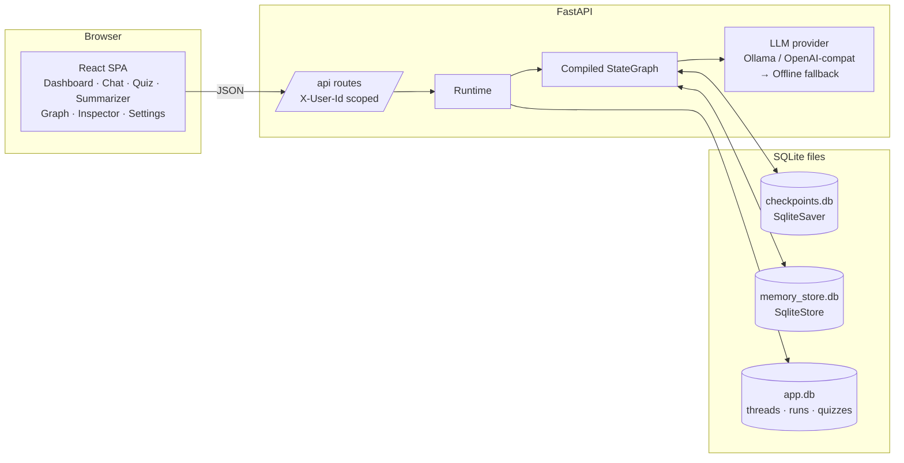
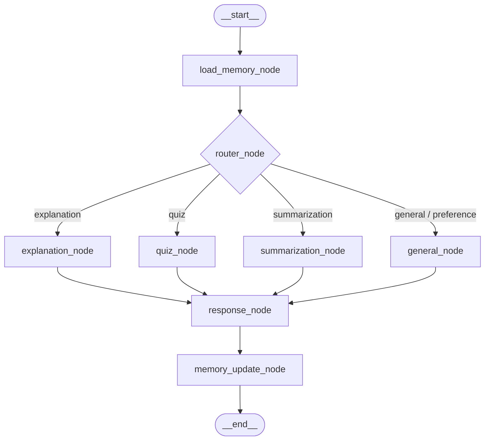

# StudyMate – An Intelligent AI Study Assistant

StudyMate is a study assistant built around a real, compiled **LangGraph `StateGraph`**. It explains topics, generates quizzes, summarizes uploaded notes (TXT / MD / PDF / DOCX), remembers how each student likes to learn, and lets you *see* all of it: the graph, the path every request took, the checkpointed state, the token budget and the stored profile.

- Backend: FastAPI + LangGraph + SQLite (checkpointer and long-term store)
- Frontend: React 19 + Vite + TypeScript + Tailwind v4
- LLM: Ollama by default (local), any OpenAI-compatible API optionally, and a clearly-labelled offline fallback so the app and the tests work with no model installed

See also [`docs/architecture.md`](docs/architecture.md) and [`docs/setup.md`](docs/setup.md).

## 1. Features

| Section | What it does |
|---|---|
| Dashboard | Conversations, graph runs per intent, quiz scores, recent topics and the learning profile, all read from the databases |
| Study Chat | Threaded chat with Markdown/code/math rendering, per-run panel (path, router reason, context stats, memory used/changed) |
| Quiz Generator | Topic + difficulty + count → multiple-choice quiz via the quiz node; answers stay on the server until you submit; weak topics (<70%) go to `revision_areas` |
| Notes Summarizer | Paste or upload a file; map-reduce chunking for long documents; summary, key concepts, revision notes, key terms |
| Graph Explorer | The graph drawn from `get_graph()` data, execution overlay, node inspector (reads/writes/edges), reducers, state fields, Mermaid source, run-a-message box |
| Memory & State Inspector | Short-term: checkpoints, insights reducer output. Long-term: editable/deletable profile with its namespace. Context: token statistics and per-message decisions |
| Settings | User switch (separate memory namespace), context-budget override, LLM status, delete-all-data |

## 2. Architecture



## 3. Technology stack

Python 3.13, FastAPI, LangGraph, langgraph-checkpoint-sqlite, langchain-core, Pydantic v2, SQLite, tiktoken, httpx, pypdf, python-docx, pytest, ruff. React 19, React Router 7, Vite, TypeScript, Tailwind CSS 4, Lucide, react-markdown (+ KaTeX, highlight.js), Vitest + Testing Library, ESLint.

## 4. LangGraph implementation



This is the shape reported by `graph.get_graph()`; the UI and the Mermaid block in Graph Explorer are generated from that object, not hand-drawn.

- **Nodes** (`backend/app/graph/nodes.py`): `load_memory_node` reads the profile from the Store; `router_node` classifies intent (forced intent → rules → LLM classifier → default `explanation`); `explanation_node`, `quiz_node`, `summarization_node`, `general_node` produce content; `response_node` finalizes the assistant message; `memory_update_node` writes learned preferences/topics back to the Store.
- **Conditional edges**: `add_conditional_edges("router_node", route_by_intent, ROUTE_MAP)`. Intents `preference` and `general` share `general_node`.
- **Compilation** (`backend/app/runtime.py`): `build_graph(...).compile(checkpointer=SqliteSaver, store=SqliteStore)`. Nodes receive the store through LangGraph's keyword injection.
- Every node is wrapped by a `traced` decorator that records name, status, duration and detail into the state.

## 5. State management

`StudyState` (`backend/app/graph/state.py`) is a typed dict with: `messages`, `intent`, `topic`, `student_profile`, `retrieved_memory`, `learning_insights`, `context_statistics`, `execution_metadata`, `generated_content_type`, and request inputs. State is checkpointed by `SqliteSaver` after every step, keyed by `thread_id`, so each conversation has an isolated history with a full checkpoint list (see Inspector → Short-term).

## 6. Reducers

| Key | Reducer | Behaviour |
|---|---|---|
| `messages` | `add_messages` | Appends; same id replaces. History is never dropped from state. |
| `learning_insights` | `merge_insights` (custom) | Merge by `(kind, topic.lower())`: repeats increment `count` and union `intents` instead of duplicating. |
| `execution_metadata` | `merge_execution_metadata` (custom) | Appends node trace entries within a run; the first node's `_reset` starts a fresh trace for each new run. |

## 7. Trimming and filtering

`build_context` (`backend/app/graph/context.py`) runs **before every model call**:

1. **Filter**: drops empty messages, error replies, system messages and human messages that never got an answer.
2. **Truncate**: a single message over `MAX_MESSAGE_TOKENS` is cut head 70% / tail 30% *in the model context only*; the checkpoint keeps the original.
3. **Trim**: `langchain_core.messages.trim_messages(strategy="last", start_on="human", end_on="human")` against `CONTEXT_TOKEN_BUDGET` minus the system prompt.
4. The latest human message is always kept, even if it alone exceeds the budget (then `within_budget=false` is reported).

Statistics (`total/retained/excluded/filtered/trimmed/truncated` messages, `tokens_before/after`, budget, counter name, exactness, and a per-message decision list) are computed from the same objects that are sent to the model. The **tokenizer is tiktoken `cl100k_base` when its vocabulary can be loaded; otherwise a labelled `approx:chars/4` estimate**. The counter name and whether it is exact appear in every statistic and in the UI. Note that `cl100k_base` is not the tokenizer of Llama/Ollama models, so counts for those are an estimate either way.

## 8. Short-term memory

The `SqliteSaver` checkpointer (`data/checkpoints.db`). A thread's history, insights and trace persist across requests and server restarts; threads never see each other's state. `GET /api/threads/{id}/state` returns the latest values plus the checkpoint list that the Inspector shows.

## 9. Long-term memory

A persistent `SqliteStore` (`data/memory_store.db`). One structured profile per user at namespace `("users", <user_id>, "profile")`, key `"profile"`:
`preferred_explanation_style`, `preferred_programming_language`, `current_subjects`, `learning_preferences`, `topics_studied`, `revision_areas`.

- Written by `memory_update_node` using rule-based extraction against an allow-list (optionally an LLM pass validated against the same allow-list). Extraction only runs for explanation / preference / general turns, so pasted notes cannot teach the profile.
- Read by `load_memory_node` on every run in *any* thread, then injected into the prompts.
- Inspect / edit / delete via the Memory Inspector and `GET/PATCH/DELETE /api/memory`.
- Users are isolated by `X-User-Id`; the id is regex-validated and is the namespace.

## 10. Installation

```bash
# backend
cd backend
python -m venv ../.venv && source ../.venv/bin/activate      # Windows: ..\.venv\Scripts\activate
pip install -r requirements.txt
cp .env.example .env

# frontend
cd ../frontend
npm install
```

## 11. Environment configuration

`backend/.env` (all optional; see `.env.example`): `LLM_PROVIDER` (`ollama` | `openai` | `offline`), `LLM_FALLBACK` (`offline` | `none`), `OLLAMA_BASE_URL`, `OLLAMA_MODEL`, `OPENAI_*`, `CONTEXT_TOKEN_BUDGET`, `MAX_MESSAGE_TOKENS`, `TOKEN_COUNTER` (`auto` | `tiktoken` | `approx`), `ROUTER_MODE`, `MEMORY_EXTRACTION`, `STUDYMATE_DATA_DIR`, `CORS_ORIGINS`, `MAX_UPLOAD_BYTES`.

For the local model: `ollama serve` and `ollama pull llama3.2`.

## 12. Backend startup

```bash
cd backend
uvicorn app.main:app_factory --factory --reload      # http://127.0.0.1:8000  (docs at /docs)
```

## 13. Frontend startup

```bash
cd frontend
npm run dev                                          # http://localhost:5173 (proxies /api to :8000)
```

## 14. Testing

```bash
cd backend  && pytest                  # mocked LLM; one optional live-Ollama test (auto-skipped if unreachable)
cd backend  && ruff check .
cd frontend && npm run typecheck && npm run lint && npm test && npm run build
python scripts/e2e_demo.py             # starts a real uvicorn server, restarts it, runs the 5 demos over HTTP
```

## 15. Assignment requirements → implementation

| Requirement | Where |
|---|---|
| Compiled StateGraph, conditional routing | `graph/builder.py` (`ROUTE_MAP`, `route_by_intent`), tests in `tests/test_graph.py` |
| ≥2 reducers | `graph/state.py` (`add_messages`, `merge_insights`, `merge_execution_metadata`), `tests/test_state.py` |
| SQLite checkpointing, thread isolation, restart survival | `runtime.py`, `tests/test_state.py`, e2e Demo 2 |
| Trimming + statistics | `graph/context.py`, `tests/test_context.py`, e2e Demo 3 |
| Long-term Store memory, cross-thread, restart, per-user | `memory/profile.py`, `tests/test_memory.py`, e2e Demo 1 |
| Graph shown in UI | `GraphView.tsx` renders `/api/graph` (from `get_graph()`) |
| Real context stats in UI | `ContextInspector.tsx` renders `context_statistics` from the run |

## 16. Demonstration workflow

1. **Graph** – *Graph Explorer*: see nodes, solid (normal) and dashed (conditional) edges. Type “Explain CPU scheduling” in *Run a message* → the traversed path is highlighted and listed.
2. **Reducers** – *Study Chat*: send several messages, then *Inspector → Short-term*: message count grows via `add_messages`; the Learning insights table shows `merge_insights` counts (ask the same topic twice to see `count` rise).
3. **Thread isolation** – create Thread A (ask about deadlock), Thread B (ask about recursion); switch in the sidebar; histories differ; Inspector shows separate checkpoint lists.
4. **Trimming** – *Settings*: set a small budget (e.g. 300), send several long messages, then *Inspector → Context window*: before/after tokens, budget tick, and each message marked sent / trimmed / filtered / truncated.
5. **Long-term memory** – Thread A: “I prefer explanations using real-world analogies.” New Thread B: “Explain CPU scheduling.” The run panel lists the memory fields used and the answer follows the style. *Inspector → Long-term* shows the stored profile and its namespace. Restart the backend and repeat Thread B to see it persist.

## Limitations (what is and isn't verified)

- Verified here: backend tests, frontend typecheck/lint/build/tests, and a live HTTP end-to-end run (with a server restart) using the **offline provider**.
- **Not verified here:** a real Ollama model (none available in the build sandbox) – the Ollama and OpenAI-compatible providers are covered by mocked-HTTP tests only, and the optional live test was skipped. Answer quality with a real model has not been observed.
- tiktoken's vocabulary could not be downloaded in the sandbox, so runs here used the labelled `approx:chars/4` counter. The tiktoken code path itself was therefore not exercised in this environment (the counter test accepts either counter).
- The offline fallback is a small built-in knowledge base (6 CS topics) and an extractive summarizer. It is labelled in the UI and is not a substitute for a model; it cannot classify intent or extract preferences with an LLM.
- No authentication: `X-User-Id` is a namespace selector, not a security boundary. Intended for local use.
