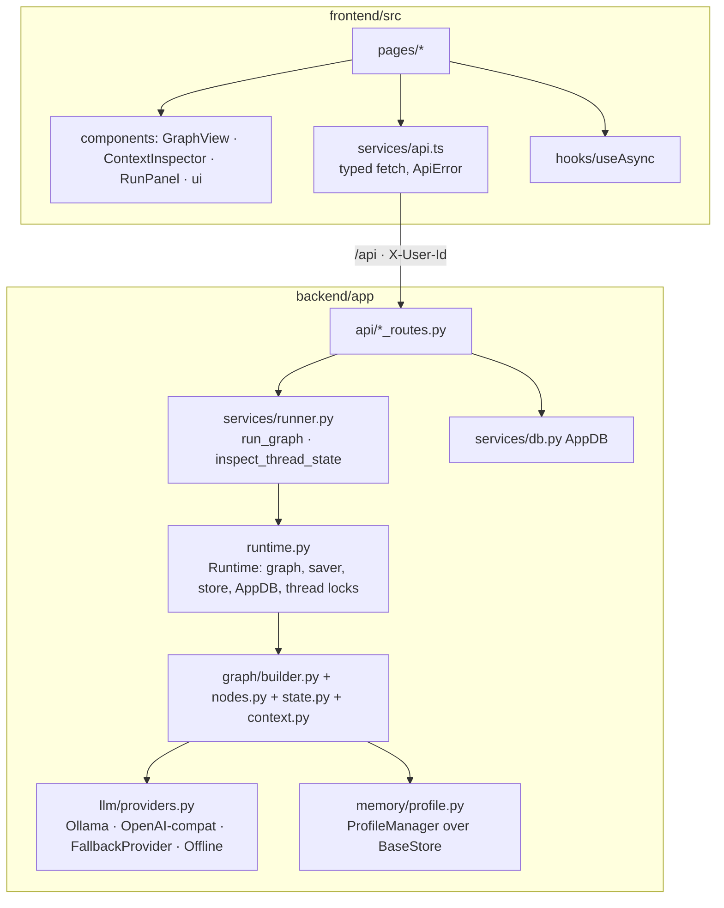

# StudyMate architecture

## Layers

## One request, step by step (`POST /api/chat`)

1. `deps.get_user_id` validates the `X-User-Id` header (`^[A-Za-z0-9_.-]{1,64}$`).
2. The thread must belong to that user (`AppDB`), otherwise 404. A per-thread lock serialises concurrent runs on the same thread.
3. `run_graph` invokes the compiled graph with `configurable = {thread_id, user_id, request_id, ...}`. (`run_id` is a reserved LangGraph key, so the request id is called `request_id`.)
4. Nodes execute: `load_memory_node → router_node → <intent node> → response_node → memory_update_node`. Each is wrapped by `traced`, which appends a trace entry through the `execution_metadata` reducer.
5. The runner serialises the final state into an *execution record* (path, trace, route reason, context statistics, retrieved memory, memory changes, LLM provider/latency) and stores it in `app.db`. The same record is returned to the UI and is what Graph Explorer / Run panel draw.
6. Errors become `{"error": {code, message, hint, node}}`; the failing node is reported and highlighted in the graph.

## Graph

| Node | Reads | Writes | Notes |
|---|---|---|---|
| `load_memory_node` | `user_id`, Store | `student_profile`, `retrieved_memory`, trace reset | Same profile for every thread of a user |
| `router_node` | latest human message | `intent`, `topic`, route info | forced intent → rules → LLM classifier (skipped if the provider is offline) → default `explanation` |
| `explanation_node` | profile, trimmed history | assistant message, insight | Prompt includes the student's style/language |
| `quiz_node` | topic, difficulty, count | structured quiz | JSON via `call_json` (lenient parse + one corrective retry), `normalize_quiz` |
| `summarization_node` | document text | structured summary | Map-reduce over chunks (max 8) when over budget |
| `general_node` | profile, history | assistant message | Used for `general` and `preference` |
| `response_node` | node output | final message + metadata | |
| `memory_update_node` | message, profile | Store, `memory_changes` | Only for explanation/preference/general, not forced intents |

Conditional edges exist only on `router_node`. Everything else is a normal edge.

## State and reducers

See README §5–6. `execution_metadata` is deliberately a reducer rather than a plain overwrite: nodes run sequentially but each contributes a trace entry, and the first node's `_reset` flag guarantees a new run starts from an empty trace even though checkpointed state is carried between turns.

## Persistence

| File (under `STUDYMATE_DATA_DIR`) | Written by | Contains |
|---|---|---|
| `checkpoints.db` | `SqliteSaver` | Short-term state, one checkpoint chain per `thread_id` |
| `memory_store.db` | `SqliteStore` | Long-term profile per user namespace |
| `app.db` | `AppDB` | Thread list/titles, execution records, quizzes (answers kept server-side) and attempts |

Deleting a thread removes its checkpoints and its app.db rows; `DELETE /api/user/data` also clears the user's profile.

## Context management

`build_context(messages, system_prompt, budget, counter, max_message_tokens)` returns `(messages_for_model, stats)`. Filtering, truncation and `trim_messages` are described in README §7. For summarization, the same function is applied to the prompt with `scope="summarization_prompt"` so the statistics describe what that call actually sent.

## LLM abstraction

`LLMProvider.invoke(messages, ...) -> LLMResult(text, provider, model, prompt_tokens, completion_tokens, latency_ms)`. `FallbackProvider` wraps the primary with a circuit breaker; when the primary is unreachable it falls back to `OfflineProvider` **only for tasks the offline provider supports** (explanation, general chat, quiz from its built-in KB, extractive summary). Classification and LLM-based extraction are not faked: they raise, and the router/extractor fall back to rules. Every execution records which provider actually answered, and the UI labels offline answers.

## Frontend data flow

Pages call typed functions in `services/api.ts`; `useAsync` keeps previous data while reloading (so lists do not flash) and derives `loading` from a request key rather than setting state in effects. `GraphView` computes its layout from the API's `nodes`/`edges` only (rank = longest path from `__start__`), and node/edge highlighting comes from the execution's `path`. The user id and budget override live in `localStorage` (guarded with try/catch) and are sent on every request.

## Security notes

- No authentication; `X-User-Id` partitions data and is validated, but is not a secret. Do not expose the API publicly.
- Uploads: extension allow-list, size cap (`MAX_UPLOAD_BYTES`), parsed in-process by pypdf / python-docx, text length capped.
- Quiz answers are never sent to the client before `submit`.
- CORS origins are configurable; the default allows the Vite dev server only.
- Model output is rendered through react-markdown (no raw HTML).
